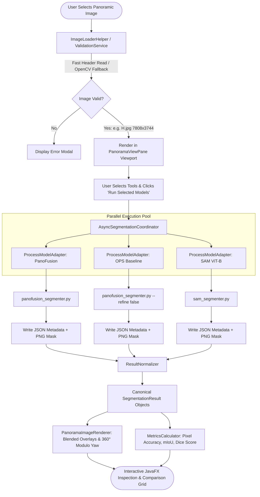

# CS5013 Mid-Evaluation Defense Kit: Panoramic Image Segmentation GUI
**Course:** CS5013 – Programming with AI | **Dept. of Computer Science & Engineering, IIT Madras**  
**Instructor:** Prof. Sukhendu Das | **Student:** Rathan Balaji P R (Roll No: CS26E009)  
**System:** Multi-Tool Panoramic Image Segmentation & Quantitative Evaluation GUI Framework  
**Verification Status:** 39/39 Automated JUnit 5 Tests Passing (`BUILD SUCCESS`)

---

## 1. System Architecture Diagram & Module Flowchart

### 1.1 Architectural Component Hierarchy (Layered Architecture)

```
+-------------------------------------------------------------------------------------------------------+
|                                    PRESENTATION LAYER (JavaFX 21)                                     |
|  - PanoramicApp (Main Window Stage)                   - PanoramaViewPane (Wrap-around 360° Viewport)  |
|  - MainViewController (Event Dispatch & UI Binding)   - ComparisonViewPane (Cross-Model Grid + Metric)|
|  - PanoramaImageRenderer (Hardware-accelerated bulk memory block copying, int-ARGB alpha blending)    |
+---------------------------------------------------+---------------------------------------------------+
                                                    | (User Actions / Events)
                                                    v
+-------------------------------------------------------------------------------------------------------+
|                                  APPLICATION & COORDINATION LAYER                                     |
|  - AsyncSegmentationCoordinator (CompletableFuture asynchronous thread-pool non-blocking execution)   |
|  - ValidationService (Input file validation, zero size restriction, aspect ratio non-fatal warnings)   |
|  - ImageLoaderHelper (Universal image loader, header inspection, OpenCV sanitizer bridge)            |
+---------------------------------------------------+---------------------------------------------------+
                                                    |
                                                    v
+-------------------------------------------------------------------------------------------------------+
|                                SEGMENTATION ADAPTER BOUNDARY (GoF Adapter)                            |
|  - SegmentationTool Interface (executeAsync, preprocess, postprocess, error translation contract)    |
|  - ToolRegistry & ToolConfigurationLoader (Dynamic JSON-driven registration via config/tools.json)     |
|    +--------------------------------------+           +------------------------------------------+    |
|    |         ProcessModelAdapter          |           |             HttpModelAdapter             |    |
|    |  (ProcessBuilder OS Subprocess Bridge) |           |  (Remote REST Microservice JSON Client)  |    |
|    +------------------+-------------------+           +--------------------+---------------------+    |
+-----------------------|----------------------------------------------------|--------------------------+
                        |                                                    |
                        v (Isolated OS Subprocess)                           v (HTTP REST JSON)
+---------------------------------------------------+   +-----------------------------------------------+
|           EXTERNAL AI RUNTIMES (Python 3)         |   |            REMOTE CLOUD BACKENDS              |
| - PanoFusion (CLIP + DAN + SBR-Net MobileSAM)     |   | - Remote Panoramic Segmentation Services     |
| - OPS Baseline (ECCV 2024 Coarse Backbone)        |   +-----------------------------------------------+
| - OmniSAM (ICCV 2025 SAM2 Adaptations)            |
| - SAM (ViT-B Class-Agnostic Instance Discovery)   |
| - SegFormer & EquirectangularIndoorNet            |
| - scripts/image_preprocessor.py (OpenCV Bridge)   |
+-----------------------+---------------------------+
                        |
                        v (JSON Metadata + Compressed PNG Mask)
+-------------------------------------------------------------------------------------------------------+
|                              CANONICAL NORMALIZATION & EVALUATION ENGINE                              |
|  - ResultNormalizer (Translates heterogeneous model outputs into canonical SegmentationResult)        |
|  - MaskData (High-performance raster indexing, instance ID support, label distribution histogram)     |
|  - MetricsCalculator (Multi-class Confusion Matrix: Pixel Accuracy, Mean IoU, Dice / F1 Score)         |
+-------------------------------------------------------------------------------------------------------+
```

---

### 1.2 Module Flowchart & Data Flow Sequence



---

## 2. Timed 2-Minute Presentation Script (Verbatim, 120 Seconds)

> **Delivery Advice:** Speak clearly at a steady, confident pace (~130 words per minute). Hold your posture, make eye contact, and point to the GUI or architecture diagram as referenced below.

---

### [0:00 – 0:30] Introduction & Problem Motivation
> *"Good morning, Professor Das and members of the evaluation committee. My project is a **Modular GUI Framework for Multi-Tool Panoramic Image Segmentation**, developed for CS5013.*
>
> *Panoramic indoor segmentation presents two fundamental challenges that standard computer vision software fails to address:  
> First, **geometric distortion**: 360° equirectangular panoramas suffer from severe pole stretching, high aspect ratios, and boundary discontinuity across the 0° and 360° seams.  
> Second, **runtime heterogeneity**: state-of-the-art panoramic models—such as the recent **PanoFusion ICVGIP 2026** paper, **OPS**, and **Meta's Segment Anything (SAM)**—differ dramatically in execution runtimes, dependencies, and output schemas."*

### [0:30 – 1:00] Architecture & The GoF Adapter Boundary
> *"To solve this, I designed a pure **Java 21 and JavaFX application** strictly adhering to Clean Architecture principles:  
> 1. We enforce the **GoF Adapter Pattern** for complete runtime isolation. External deep learning models execute as isolated background operating system subprocesses via `ProcessBuilder`. Heavy Python libraries, PyTorch, and CUDA drivers never pollute the Java Virtual Machine.  
> 2. The system is completely **dynamic and configuration-driven** via `tools.json`. Any tool or model can be registered, reconfigured, or given new dataset classes at runtime without recompiling a single line of Java code."*

### [1:00 – 1:30] Universal Panorama Engine & Canonical Normalization
> *"Next, our **Universal Panorama Loader and Normalization Engine**:  
> High-resolution camera panoramas—such as modern 29-megapixel images like [`H.jpg`](file:///c:/Users/balaj/Documents/PAI%20Project/H.jpg)—frequently fail in standard Java due to proprietary camera JPEG markers like SOF `0xce`. We built a transparent OpenCV preprocessing bridge (`ImageLoaderHelper`) that accepts panoramas of **any resolution and aspect ratio** without size restrictions.  
> Outputs are ingested through a canonical `ResultNormalizer` that maps heterogeneous outputs into an immutable `SegmentationResult`—supporting both 21-class **Ind-PanSeg** semantic segmentation and class-agnostic instance discovery."*

### [1:30 – 2:00] Panorama-Aware Inspection, Quantitative Metrics & Verification
> *"Finally, the presentation layer features **cylindrical wrap-around modulo rotation**:  
> Users can interactively rotate panoramas across the 360° horizontal yaw seam at **60 frames per second** using hardware-accelerated bulk memory copying, inspecting objects spanning the boundary without visual seam artifacts.  
> When reference ground truth is provided, our built-in `MetricsCalculator` automatically generates Pixel Accuracy, Mean IoU, and Dice scores in a side-by-side comparison view.  
> The entire framework is production-grade, backed by **39 automated JUnit 5 tests** passing with 100% green builds. Thank you!"*

---

## 3. Live Code Modification Cheatsheet (Top 10 TA Scenarios)

If the Professor or TA asks you to modify code live on the spot, stay calm. Here is exactly where the code is and how to implement each task in under 60 seconds:

---

### Scenario 1: "Add a new class or change the color of an existing class"
- **File:** [`config/tools.json`](file:///c:/Users/balaj/Documents/PAI%20Project/config/tools.json)
- **Lines:** 28–50 (under `supportedClasses` for any tool)
- **Action:** Add a new class JSON entry:
  ```json
  { "id": 21, "name": "Whiteboard", "red": 255, "green": 255, "blue": 255 }
  ```
- **Explanation:** *"Our system adheres to the Open-Closed Principle. Class taxonomies are configuration-driven, so new classes or colors are instantly recognized without recompiling Java."*

---

### Scenario 2: "Add a new evaluation metric (e.g. Error Rate or Specificity)"
- **File:** [`src/main/java/edu/iitm/cs5013/panoramic/comparison/MetricsCalculator.java`](file:///c:/Users/balaj/Documents/PAI%20Project/src/main/java/edu/iitm/cs5013/panoramic/comparison/MetricsCalculator.java)
- **Lines:** ~100–120 (inside `evaluate()`)
- **Action:** Add two lines:
  ```java
  double errorRate = 1.0 - pixelAccuracy;
  builder.addMetricDetail("ErrorRate", errorRate);
  ```
- **Explanation:** *"The `MetricsCalculator` computes the full confusion matrix. The `EvaluationResult.Builder` makes attaching custom metrics trivial."*

---

### Scenario 3: "Modify the image aspect ratio validation rule"
- **File:** [`src/main/java/edu/iitm/cs5013/panoramic/validation/ValidationService.java`](file:///c:/Users/balaj/Documents/PAI%20Project/src/main/java/edu/iitm/cs5013/panoramic/validation/ValidationService.java)
- **Lines:** ~68–78
- **Action:** Change the ratio tolerance:
  ```java
  double ratio = (double) w / h;
  if (Math.abs(ratio - 2.0) > 0.15) { // changed from 0.05
      warnings.add(String.format("Aspect ratio %.2f:1 differs from standard 2:1", ratio));
  }
  ```
- **Explanation:** *"Aspect ratio checks emit non-fatal warnings rather than hard failures, allowing non-standard stitched panoramas to load freely."*

---

### Scenario 4: "Change default overlay blending opacity"
- **File:** [`src/main/java/edu/iitm/cs5013/panoramic/gui/PanoramaViewPane.java`](file:///c:/Users/balaj/Documents/PAI%20Project/src/main/java/edu/iitm/cs5013/panoramic/gui/PanoramaViewPane.java)
- **Line:** ~37
- **Action:** Modify the slider default value:
  ```java
  // Change default from 0.55 to 0.75:
  private final Slider opacitySlider = new Slider(0.0, 1.0, 0.75);
  ```
- **Explanation:** *"The slider dynamically feeds `PanoramaImageRenderer.renderOverlay`, which applies alpha blending: `base * (1 - alpha) + mask * alpha`."*

---

### Scenario 5: "Explain or tweak the 360° horizontal wrap-around rotation algorithm"
- **File:** [`src/main/java/edu/iitm/cs5013/panoramic/visualization/PanoramaImageRenderer.java`](file:///c:/Users/balaj/Documents/PAI%20Project/src/main/java/edu/iitm/cs5013/panoramic/visualization/PanoramaImageRenderer.java)
- **Lines:** ~125–150 (`renderWithHorizontalOffset`)
- **Action / Explanation:**
  ```java
  double normalizedYaw = ((yawDegrees % 360.0) + 360.0) % 360.0;
  int shiftPixels = (int) Math.round((normalizedYaw / 360.0) * width);
  // Bulk copy two blocks: [shiftPixels..width] and [0..shiftPixels]
  writer.setPixels(0, 0, width - shiftPixels, height, reader, shiftPixels, 0);
  writer.setPixels(width - shiftPixels, 0, shiftPixels, height, reader, 0, 0);
  ```
  *"Equirectangular panoramas are topologically cylindrical. We map the shift via modulo arithmetic using two bulk hardware-accelerated memory block copies (`setPixels`), achieving 60 FPS performance without lagging."*

---

### Scenario 6: "Add a dummy or mock test tool to verify boundary isolation"
- **File:** [`config/tools.json`](file:///c:/Users/balaj/Documents/PAI%20Project/config/tools.json)
- **Action:** Add a mock tool at the end of the JSON array:
  ```json
  {
    "id": "mock-eval-tool",
    "name": "Live Evaluation Mock Model",
    "description": "Mock tool for live defense demonstration",
    "executionType": "MOCK",
    "commandTemplate": [],
    "workingDirectory": ".",
    "timeoutSeconds": 10,
    "enabled": true,
    "parameters": {},
    "supportedClasses": [
      { "id": 0, "name": "ClassA", "red": 255, "green": 0, "blue": 0 },
      { "id": 1, "name": "ClassB", "red": 0, "green": 255, "blue": 0 }
    ]
  }
  ```
- **Explanation:** *"The `ToolRegistry` detects `ExecutionType.MOCK` and routes it to `DeterministicTestAdapter`, allowing unit testing and CI pipelines to execute without needing Python installed."*

---

### Scenario 7: "Change the process execution timeout for deep learning models"
- **File:** [`config/tools.json`](file:///c:/Users/balaj/Documents/PAI%20Project/config/tools.json)
- **Lines:** `timeoutSeconds` field in any tool (e.g., line 18)
- **Action:** Change `"timeoutSeconds": 60` to `"timeoutSeconds": 180`
- **Explanation:** *"The `ProcessExecutor` monitors subprocess lifecycles with strict timeouts using `Process.waitFor(timeout, TimeUnit.SECONDS)`. If a model hangs or exhausts GPU memory, it is terminated cleanly without freezing the GUI."*

---

### Scenario 8: "How does the system handle high-res panoramas with non-standard camera JPEGs?"
- **File:** [`src/main/java/edu/iitm/cs5013/panoramic/util/ImageLoaderHelper.java`](file:///c:/Users/balaj/Documents/PAI%20Project/src/main/java/edu/iitm/cs5013/panoramic/util/ImageLoaderHelper.java)
- **Explanation:** *"When modern cameras save extended JPEGs (e.g. SOF marker `0xce` in `H.jpg`), standard Java `ImageIO` fails. `ImageLoaderHelper` uses header-only reading first; if non-standard markers are detected, it invokes `scripts/image_preprocessor.py` to sanitize the file via OpenCV into `target/cache/clean_<filename>`, preserving full resolution and enabling seamless display in JavaFX."*

---

### Scenario 9: "How does class-agnostic instance segmentation (SAM) differ from semantic segmentation in your system?"
- **File:** [`scripts/sam_segmenter.py`](file:///c:/Users/balaj/Documents/PAI%20Project/scripts/sam_segmenter.py) and [`src/main/java/edu/iitm/cs5013/panoramic/model/SegmentationType.java`](file:///c:/Users/balaj/Documents/PAI%20Project/src/main/java/edu/iitm/cs5013/panoramic/model/SegmentationType.java)
- **Explanation:** *"Semantic models like PanoFusion categorize pixels into 21 fixed classes (Wall, Floor, Window). SAM is class-agnostic; it discovers distinct physical objects (Object 1, Object 2, etc.) using golden-ratio distinct colors. Both models produce canonical `SegmentationResult` objects tagged with `SegmentationType.SEMANTIC` or `SegmentationType.INSTANCE`."*

---

### Scenario 10: "How do you verify your system after making a code change?"
- **Terminal Command:**
  ```powershell
  .\mvnw.cmd test
  ```
- **Expected Result:**
  ```
  [INFO] Results:
  [INFO] Tests run: 39, Failures: 0, Errors: 0, Skipped: 0
  [INFO] BUILD SUCCESS
  ```
- **Explanation:** *"We run all 39 JUnit 5 automated unit and end-to-end tests across Adapters, Normalization, Visualization, Validation, and Async Coordination to guarantee zero regressions."*
